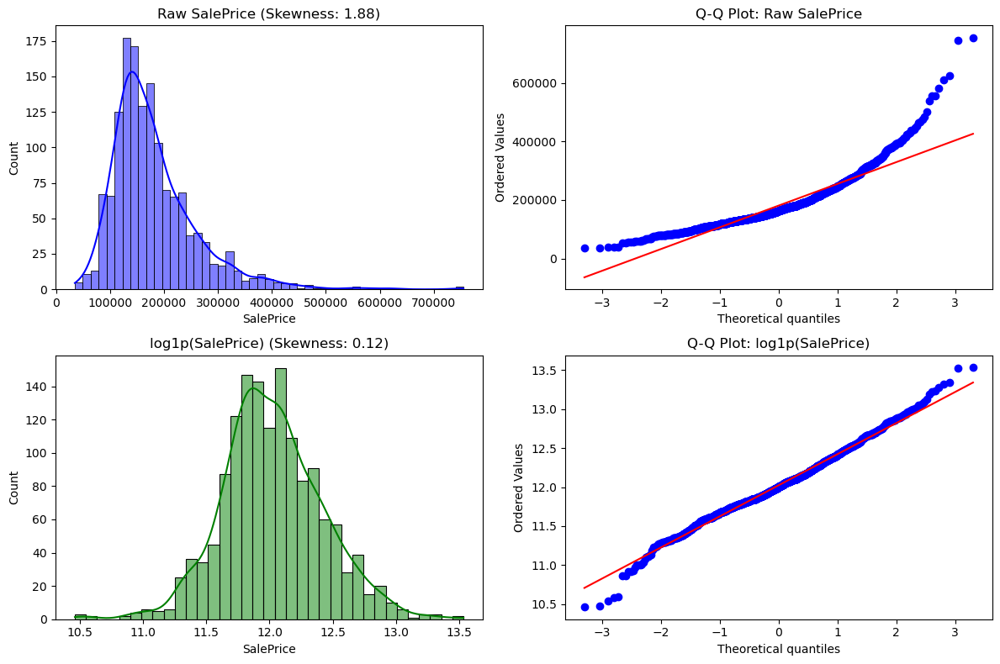
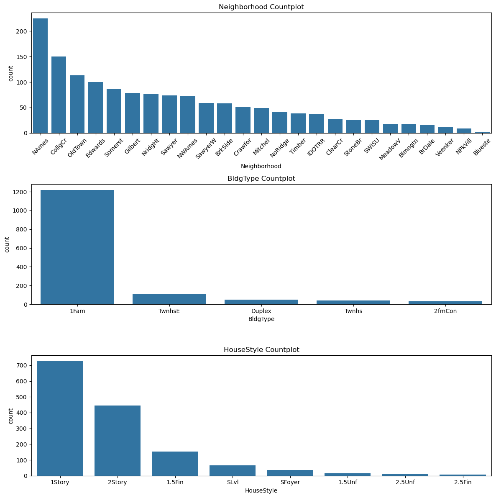
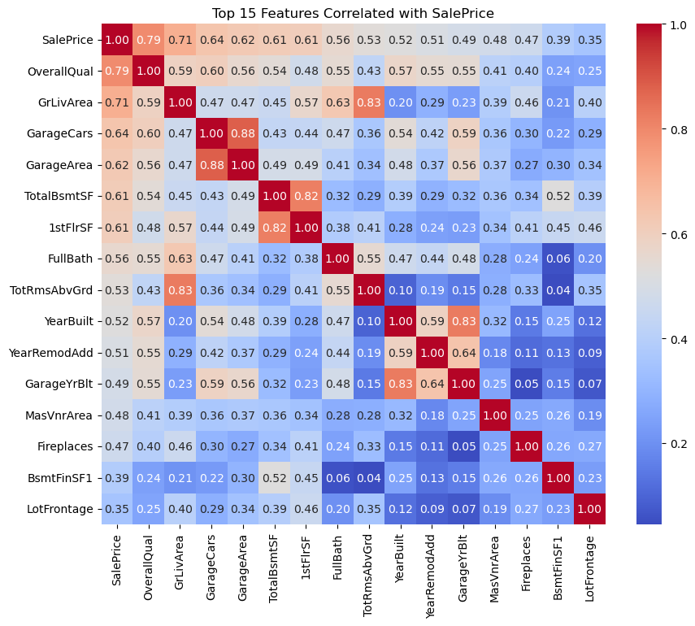
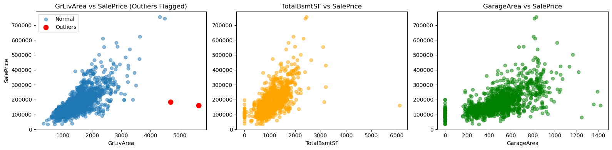
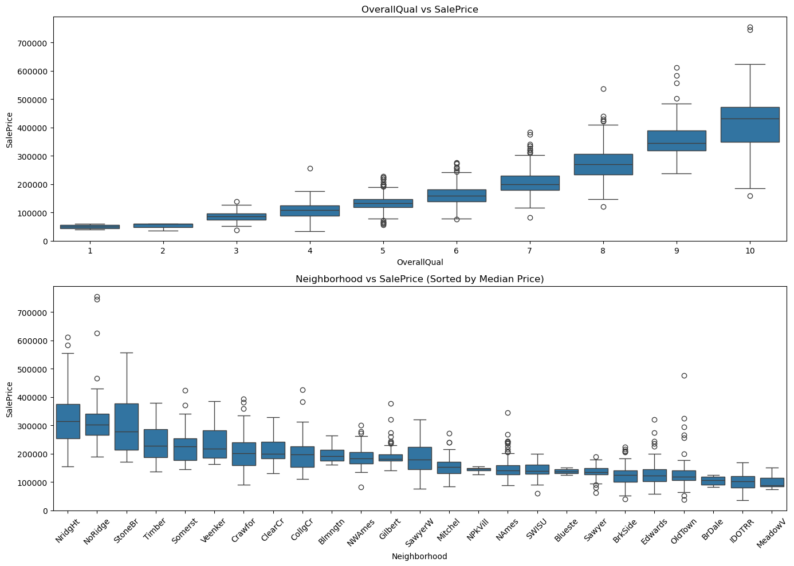
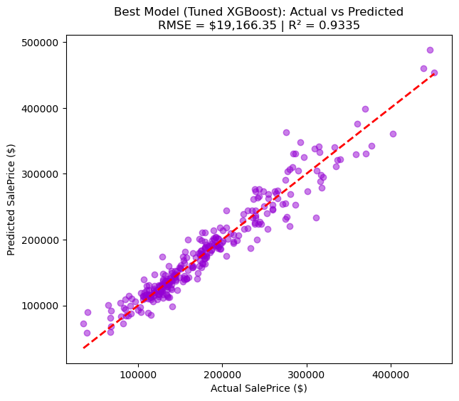
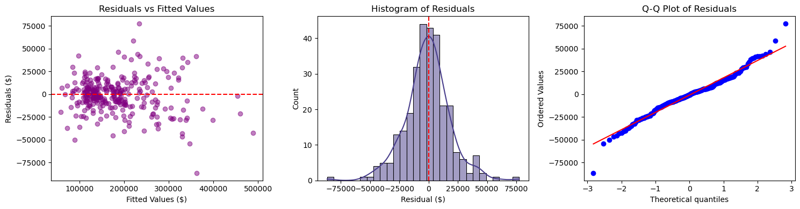
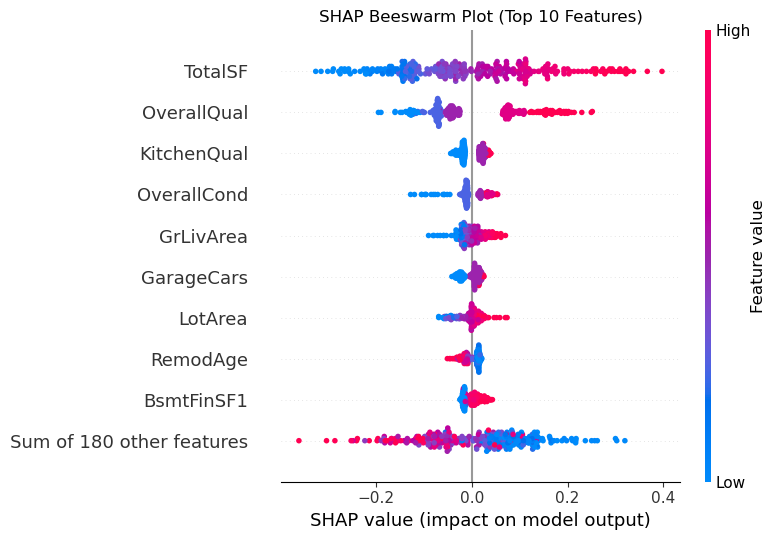
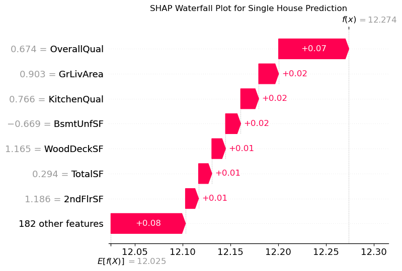

# 🏡 Ames House Price Estimator

> An automated residential property valuation pipeline built with Supervised Learning on the Ames Housing Dataset.

---

## ⚡ Quick Architecture Pipeline


---

## 1. 🔍 Target Distribution (Raw vs log1p)
> **Problem:** `SalePrice` was heavily right-skewed.  
> **Solution:** Applying `log1p` normalized the target for homoscedastic errors.



---

## 2. 📊 Univariate & Categorical Patterns
> Top distribution patterns across high-impact categories (`Neighborhood`, `BldgType`, `HouseStyle`).



---

## 3. 🎯 Top Features & Critical Outlier Flagging
> **Outlier Fix:** Two extreme houses (>4,000 sq ft & <\$300k) were high-leverage points tilting the OLS plane; removing them was essential.

| Correlation Heatmap (Top 15) | Bivariate Scatters & Outliers Flagged |
| :---: | :---: |
|  |  |

---

## 4. 🏷️ Price Drivers: Quality & Neighborhood
> Higher `OverallQual` exponentializes price; neighborhoods like **NridgHt** and **NoRidge** command top valuation.



---

## 5. 🤖 Model Benchmarking & Performance

| Model | Test RMSE ($) | Test MAE ($) | R² Score | Training Time |
| :--- | :---: | :---: | :---: | :---: |
| **Linear Regression** | \$22,630.09 | \$15,809.65 | 0.9073 | 0.007s |
| **Ridge Regression (L2)** | \$20,496.55 | \$14,689.64 | 0.9239 | 0.013s |
| **Lasso Regression (L1)** | \$20,058.13 | \$14,724.30 | 0.9272 | 0.071s |
| **Random Forest** | \$23,215.93 | \$16,306.66 | 0.9024 | 0.521s |
| **XGBoost (Baseline)** | \$19,811.79 | \$14,348.33 | 0.9289 | 0.352s |
| 🏆 **Tuned XGBoost** | **\$19,635.92** | **\$14,161.55** | **0.9302** | 22.84s |

---

## 6. 🏆 Champion Model: Tuned XGBoost
> Tight alignment along the ideal $y = x$ benchmark line ($R^2 = 0.9302$, $\text{RMSE} = \$19,635.92$).



---

## 7. 📈 Residual Diagnostics
> Residuals are randomly scattered around zero with near-normal distribution and constant variance (homoscedasticity).



---

## 8. 🧠 Explainability with SHAP Values
> **Top Market Drivers:** `TotalSF` (usable size), `OverallQual` (build quality), and `HouseAge` dominate predictions.

| Global Impact (Beeswarm) | Single Property Breakdown (Waterfall) |
| :---: | :---: |
|  |  |

---

## 9. 🚀 Fast Inference & Testing

```python
import joblib, numpy as np, pandas as pd

# 1. Load Model
model = joblib.load('house_price_model.pkl')

# 2. Predict on sample property
pred_price = np.expm1(model.predict(sample_features))
print(f"Predicted Valuation: ${pred_price[0]:,.2f}")
```

### ✅ Unseen Samples Validation

| Actual Price | Predicted Price | Error % |
| :---: | :---: | :---: |
| **\$208,500.00** | **\$205,000.97** | **1.68%** |
| **\$181,500.00** | **\$179,478.88** | **1.11%** |
| **\$223,500.00** | **\$214,350.92** | **4.09%** |
| **\$140,000.00** | **\$146,233.70** | **4.45%** |
