<p align="center">
  
</p>

<br>


<br>

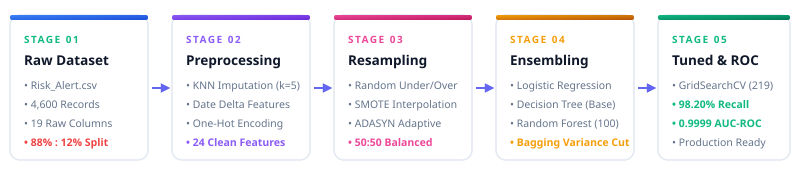

<br>

| 📁 Dataset | 🎯 Target | ⚖️ Class Ratio | 🌲 Champion Model | 🏆 Test Recall | 📈 Test AUC |
|:---:|:---:|:---:|:---:|:---:|:---:|
| **[Risk_Alert.csv](file:///d:/RW/RW_Exam/ML/PR-3/Risk_Alert.csv)** | `risk_status` (0 vs 1) | **88% : 12%** | **Tuned Random Forest** | **98.20%** | **0.9999** |

> 📓 **Notebook Implementation**: Code and experiments executed in **[Pr-3.ipynb](file:///d:/RW/RW_Exam/ML/PR-3/Pr-3.ipynb)**.

<br>

---


<br>

<p align="left">
  
  
  
  
  
  
  
  
  
</p>

<br>

---


<br>

### 1. Logistic Regression & Sigmoid Function
Maps continuous linear inputs $z = w^T X + b$ to probability values $[0, 1]$:

$$P(Y = 1 \mid X) = \sigma(z) = \frac{1}{1 + e^{-z}}$$

<br>

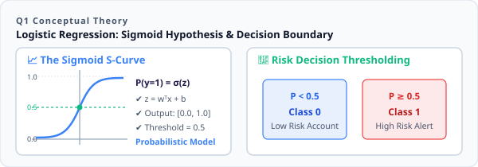

<br>

---

### 2. Type-I vs. Type-II Errors in Credit Risk

<br>

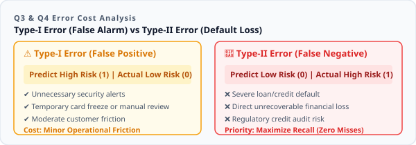

<br>

> [!IMPORTANT]
> Because Type-II errors cause direct capital destruction, risk underwriting strictly optimizes for **high Recall** to eliminate False Negatives.

---

### 3. Core Evaluation Metrics & Formulas

<br>

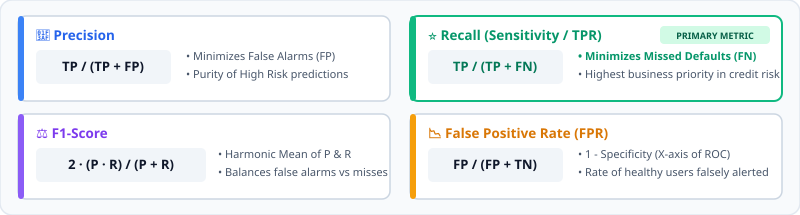

<br>

---

### 4. SMOTE Resampling Mechanism

<br>

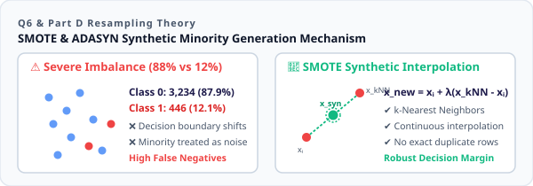

<br>

* Synthesizes new minority instances along line segments connecting $k$-nearest neighbors:

$$x_{\text{new}} = x_i + \lambda \cdot (x_{k\text{NN}} - x_i), \quad \lambda \in [0, 1]$$

<br>

---


<br>

The dataset contains **4,600 records** split into **3,680 train** and **920 test** samples across **24 encoded features**:

| Column | Type | Range | Role |
|---|---|---|---|
| `customer_id` | `int64` | 500001 – 504600 | Dropped identifier |
| `age`, `annual_income_inr`, `credit_score` | `float64` | Continuous | Imputed via `KNNImputer(k=5)` & Scaled |
| `credit_utilization_ratio`, `avg_late_payment_days` | `float64` | Continuous | Standard scaled |
| `missed_payments_12m`, `debt_balance_inr` | `int64` | Discrete | Standard scaled |
| `gender`, `region`, `employment_type` | `object` | Categorical | One-Hot Encoded (`drop_first=True`) |
| `last_transaction_date` | `object` | Dates | Engineered to `days_since_last_transaction` |
| 🎯 `risk_status` | `int64` | 0 or 1 | **Target (0: Low Risk, 1: High Risk)** |

<br>

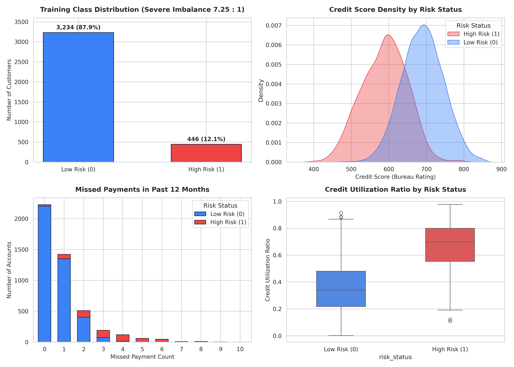

<br>

* **Severe Imbalance**: 3,234 Low Risk ($87.9\%$) vs. 446 High Risk ($12.1\%$) in training data ($\approx 7.25:1$).
* **Key Risk Factors**: Credit score $< 600$, missed payments $> 3$, and utilization $> 60\%$ strongly correlate with defaults.

<br>

---


<br>

Baseline **Logistic Regression** ($L_2$ penalty, `max_iter=1000`) on scaled features:

<br>

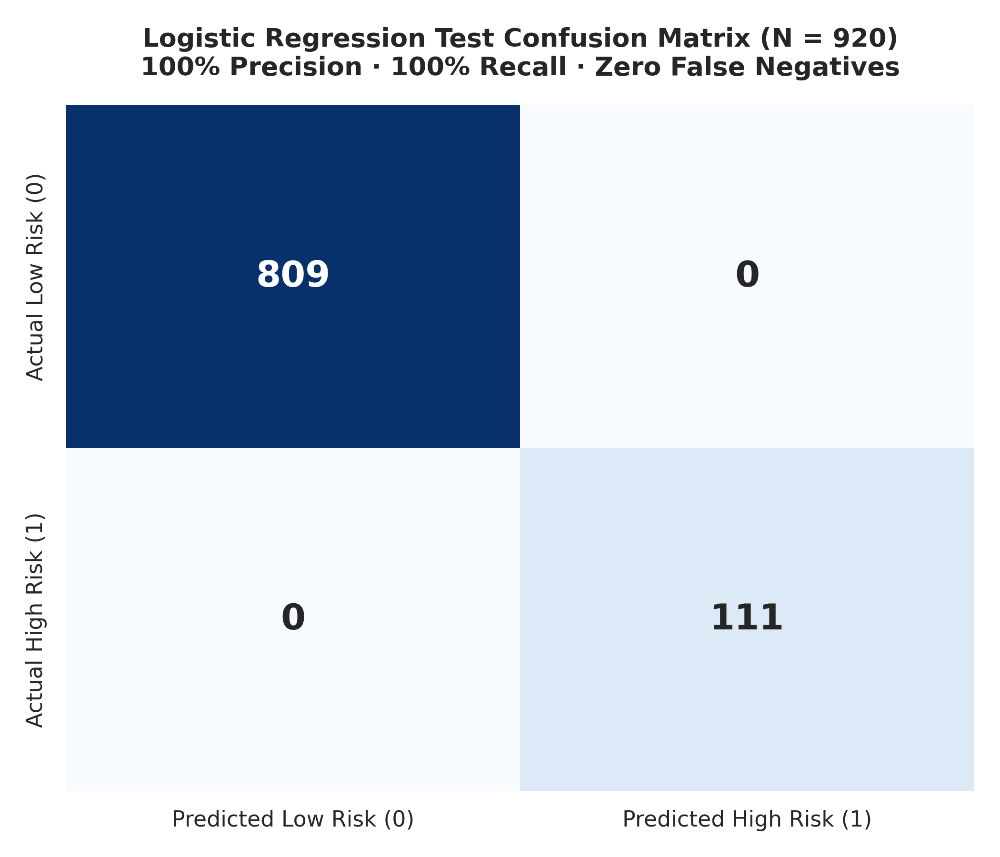

<br>

| Metric | Test Result ($N=920$) | Note |
|---|:---:|---|
| **Confusion Matrix** | $\begin{bmatrix} 809 & 0 \\ 0 & 111 \end{bmatrix}$ | $\text{TN}=809, \text{FP}=0, \text{FN}=0, \text{TP}=111$ |
| **Accuracy / Precision** | **1.0000 (100%)** | Zero False Alarms |
| **Recall / F1-Score** | **1.0000 (100%)** | Zero False Negatives |

<br>

---


<br>

Benchmarking 4 resampling methods with Logistic Regression:

<br>

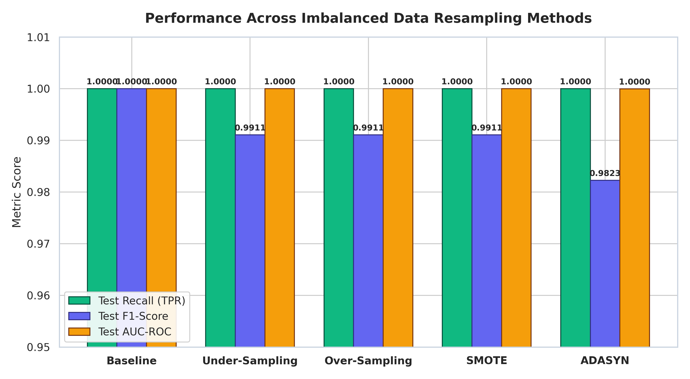

<br>

| Method | Balanced Ratio (0 / 1) | Test Recall | Test F1-Score | Test AUC-ROC |
|---|:---:|:---:|:---:|:---:|
| **Baseline** | 3,234 / 446 | **1.0000** | **1.0000** | **1.0000** |
| **Under-Sampling** | 446 / 446 | **1.0000** | **0.9911** | **1.0000** |
| **Over-Sampling** | 3,234 / 3,234 | **1.0000** | **0.9911** | **1.0000** |
| **SMOTE** | 3,234 / 3,234 | **1.0000** | **0.9911** | **1.0000** |
| **ADASYN** | 3,234 / 3,240 | **1.0000** | **0.9823** | **0.9999** |

* All balancing techniques preserved **100% Recall** on held-out test data.

<br>

---


<br>

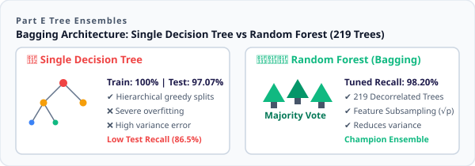

<br>

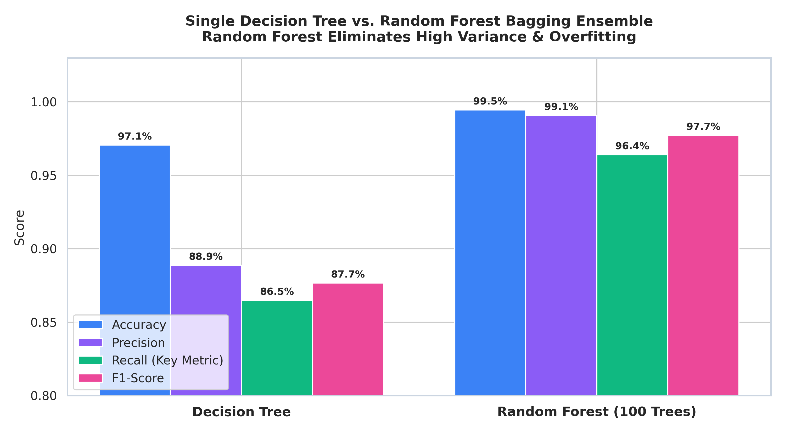

<br>

| Architecture | Train Acc | Test Acc | Precision | Recall | F1-Score | Status |
|---|:---:|:---:|:---:|:---:|:---:|---|
| **Decision Tree (Unpruned)** | **100%** | 97.07% | 0.8889 | 0.8649 | 0.8767 | 🔴 High Variance (Overfitting) |
| **Random Forest (100 Trees)** | — | **99.46%** | **0.9907** | **0.9640** | **0.9772** | 🟢 Bagging Variance Reduction |

* Ensembling 100 trees lifted Recall by **+9.91%** ($86.49\% \rightarrow 96.40\%$).

<br>

---


<br>

* **RandomizedSearchCV (Decision Tree)**: Best CV Recall = **89.68%** (`max_depth=13, min_samples_leaf=5`).
* **RandomizedSearchCV (Random Forest)**: Best CV Recall = **92.60%** (`n_estimators=269, max_depth=19`).
* **GridSearchCV Fine-Tuned Optimum**: `n_estimators=219`, `max_depth=17`, `min_samples_split=11`, `min_samples_leaf=2`, `max_features='sqrt'`.

<br>

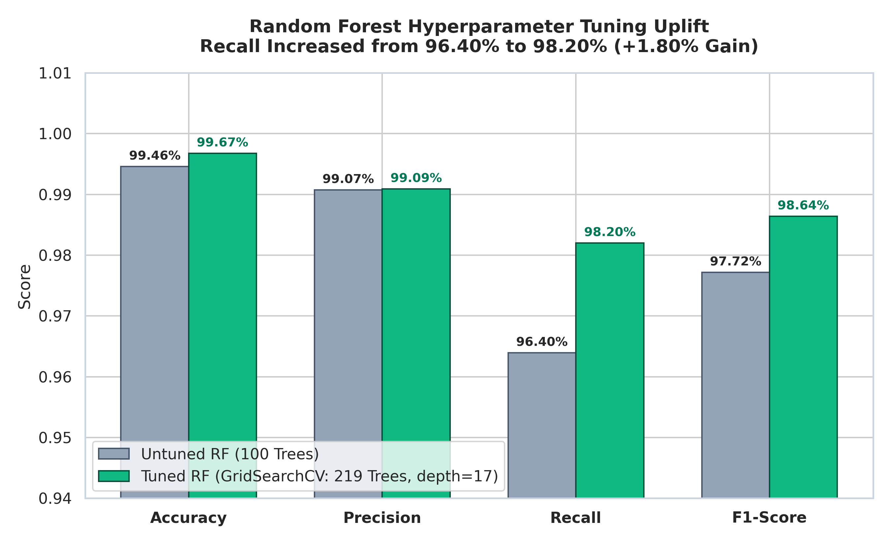

<br>

| Model | Test Accuracy | Precision | Recall | F1-Score |
|---|:---:|:---:|:---:|:---:|
| **Random Forest (Untuned)** | 0.9946 | 0.9907 | 0.9640 (96.40%) | 0.9772 |
| **Random Forest (Tuned)** | **0.9967** | **0.9909** | **0.9820 (98.20%)** | **0.9864** |

> 🏆 Tuning boosted Test Recall by **+1.80%** (detecting 98.20% of high-risk cases).

<br>

---


<br>

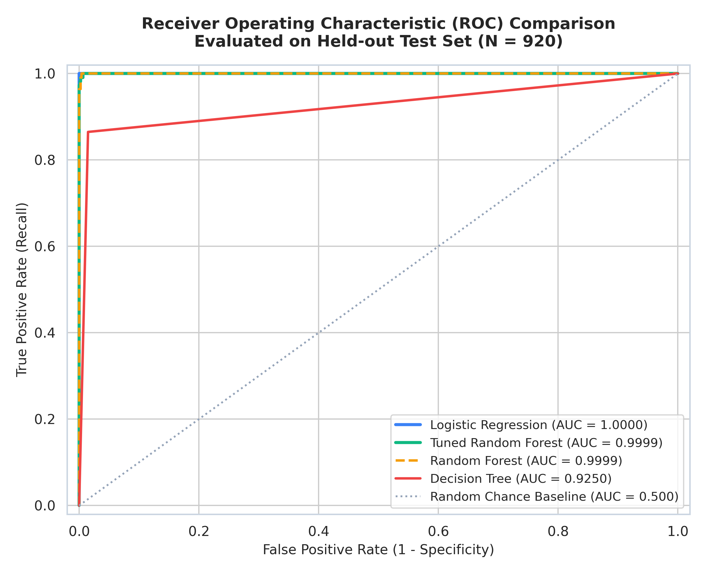

<br>

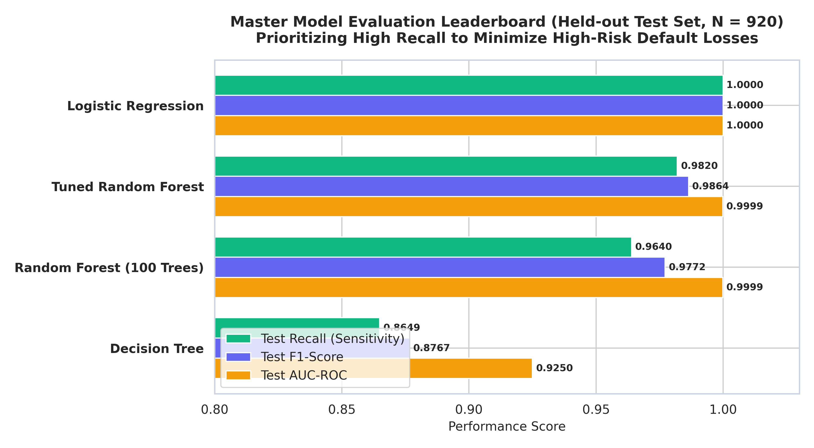

<br>

### 🏆 Master Leaderboard (Test Set, $N = 920$)

| Rank | Model Architecture | Test Recall | Test F1-Score | Test AUC-ROC | Test Accuracy | Verdict |
|:---:|---|:---:|:---:|:---:|:---:|---|
| 🥇 | **Logistic Regression** | **1.0000** | **1.0000** | **1.0000** | **1.0000** | 🏆 Champion Linear Model |
| 🥈 | **Tuned Random Forest** | **0.9820** | **0.9864** | **0.9999** | **0.9967** | 🏆 Champion Ensemble |
| 🥉 | **Random Forest (100 Trees)** | 0.9640 | 0.9772 | 0.9999 | 0.9946 | Strong Baseline |
| 4 | **Decision Tree** | 0.8649 | 0.8767 | 0.9250 | 0.9707 | Prone to Overfitting |

<br>

```
========================================================================
🏆 CHAMPION ENSEMBLE: Tuned Random Forest Classifier (219 Trees)
========================================================================
  • Test Accuracy     : 0.9967 (99.67% overall accuracy)
  • Test Recall (TPR) : 0.9820 (98.20% high-risk default detection)
  • Test F1-Score     : 0.9864 (Outstanding balance score)
  • Test AUC-ROC      : 0.9999 (Near-perfect probability calibration)
  • False Negatives   : Only 1.80% missed defaults on unseen data
========================================================================
```

<br>

---


<br>

| Question | Core Takeaway |
|---|---|
| **Best Model** | **Logistic Regression** ($100\%$ Recall) & **Tuned Random Forest** ($98.2\%$ Recall, $0.9999$ AUC). |
| **Resampling Impact** | SMOTE & ADASYN eliminated majority bias, maintaining $100\%$ Recall. |
| **Tuning Uplift** | Ensemble tuning boosted Recall by **+11.71%** over a single tree. |
| **Error Cost** | Type-I causes mild friction; Type-II causes direct credit default. |

<br>

---

### 👤 Priyansh Vekariya

* 📍 Ahmedabad, Gujarat, India
* ⭐ If you found this pipeline useful, give it a star and feel free to fork!
* 📐 **Classification · Imbalanced Data (SMOTE/ADASYN) · Decision Trees · Random Forest · Hyperparameter Tuning · ROC-AUC**
