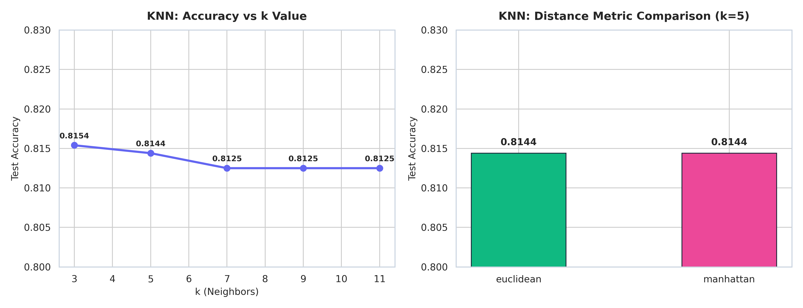
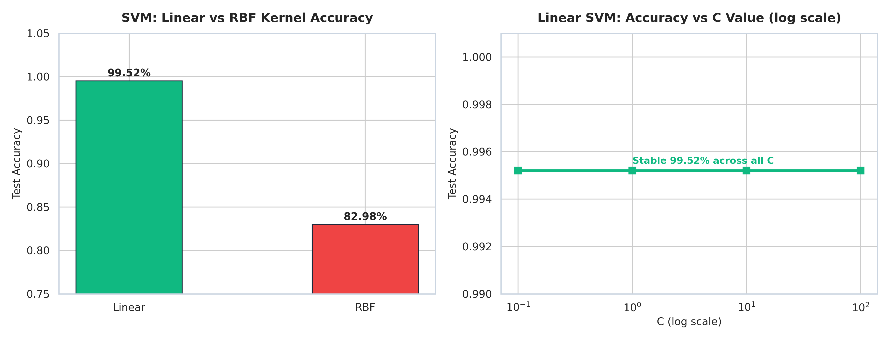
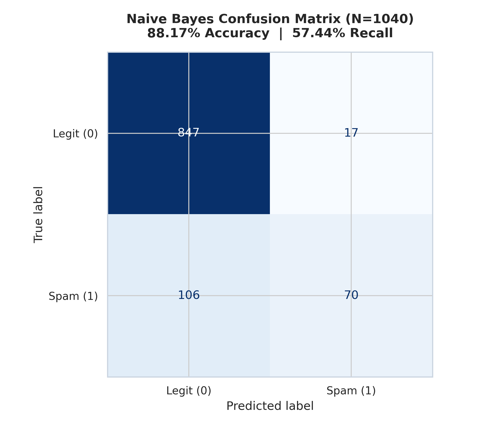
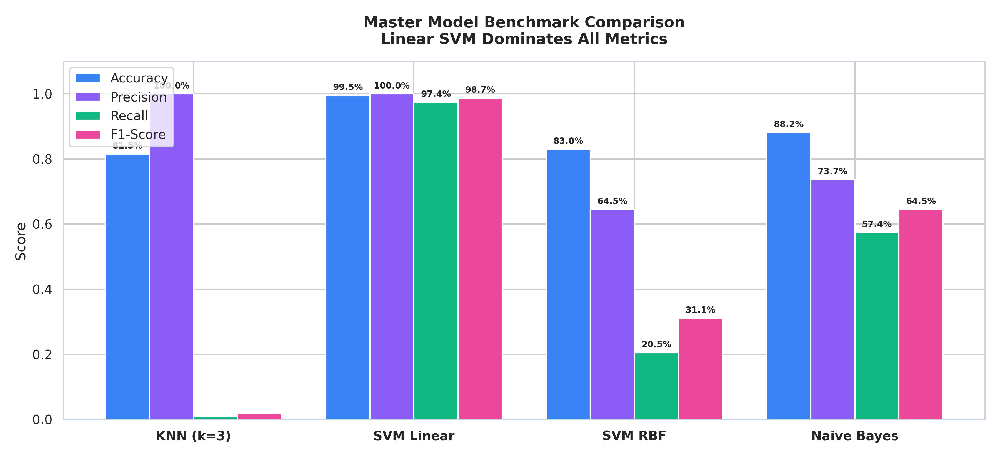

<p align="center">
  
</p>

<br>


<br>


<br>

| 📁 Dataset | 🎯 Target | ⚖️ Class Ratio | 🏆 Champion Model | ✅ Test Accuracy | 📈 Test F1-Score |
|:---:|:---:|:---:|:---:|:---:|:---:|
| **[data.csv](data.csv)** | `spam_label` (0 vs 1) | **80% : 20%** | **Linear SVM** | **99.52%** | **0.9870** |

> 📓 **Notebook Implementation**: Code and experiments executed in **[pr-4.ipynb](pr-4.ipynb)**.

<br>

---


<br>

<p align="left">
  
  
  
  
  
  
</p>

<br>

---


<br>

The dataset contains **5,200 messages** split into **4,160 train** and **1,040 test** samples across **2,894 encoded features**:

| Column | Type | Role |
|---|---|---|
| `message_id` | `int64` | Dropped identifier |
| `message_text` | `object` | Raw text (dropped after feature extraction) |
| `message_length`, `word_count` | `int64` | Text length signals |
| `num_urls`, `num_digits`, `num_special_chars` | `int64` | Content pattern signals |
| `spam_keyword_score`, `legit_keyword_score` | `int64` | Keyword-based scores |
| `sender_activity_score`, `sender_account_age_days`, `messages_sent_last_24h` | `float64` | Sender behavior — Imputed via `median` |
| `timestamp` | `object` | One-Hot Encoded (produces ~2880 columns) |
| `hour_of_day`, `day_of_week` | `int64` | Temporal features |
| 🎯 `spam_label` | `int64` | **Target (0: Legit, 1: Spam)** |

<br>

* **Missing values**: `sender_activity_score` (106), `sender_account_age_days` (113), `messages_sent_last_24h` (162) — filled with **column median**.
* `timestamp` → **One-Hot Encoded** — final shape: $(5200, 2894)$.
* All features **StandardScaled** after stratified 80/20 train-test split.

<br>

---


<br>

Baseline **KNN** (`n_neighbors=5`) on scaled 2894-dimensional features:

<br>



<br>

| Parameter | Values Tested | Best Config | Best Accuracy |
|---|:---:|:---:|:---:|
| **k (neighbors)** | 3, 5, 7, 9, 11 | `k=3` | **81.54%** |
| **Distance Metric** | euclidean, manhattan | Both equal | **81.44%** |

* **193 misclassified** messages — almost all spam predicted as legit (high False Negatives).
* KNN collapses in **2894-dimensional sparse** one-hot space — majority class dominates.

<br>

---


<br>



<br>

| Kernel | Accuracy | Precision | Recall | F1-Score |
|---|:---:|:---:|:---:|:---:|
| **Linear** | **99.52%** | **1.0000** | **97.44%** | **0.9870** |
| **RBF** | 82.98% | 0.6452 | 20.51% | 0.3113 |

* **Linear SVM stable** across all `C` values `[0.1, 1, 10, 100]` — all achieve **99.52%**.
* RBF degrades badly: one-hot high-dimensional data is **linearly separable**.

<br>

---


<br>



<br>

| Metric | Test Result ($N=1040$) | Note |
|---|:---:|---|
| **Accuracy** | **88.17%** | 123 misclassified |
| **Precision** | **73.68%** | Some false alarms |
| **Recall** | **57.44%** | Misses many spam messages |
| **F1-Score** | **64.55%** | Weakest overall balance |

* Gaussian NB assumes **feature independence** — poor fit for correlated one-hot columns.
* `predict_proba` available but calibration is poor: most samples assigned P(legit) ≈ 1.

<br>

---


<br>



<br>

### 🏆 Master Leaderboard (Test Set, $N = 1040$)

| Rank | Model | Test Accuracy | Precision | Recall | F1-Score | Verdict |
|:---:|---|:---:|:---:|:---:|:---:|---|
| 🥇 | **Linear SVM** | **99.52%** | **1.0000** | **97.44%** | **0.9870** | 🏆 Champion — Perfect Precision |
| 🥈 | **Naive Bayes** | 88.17% | 0.7368 | 57.44% | 0.6455 | Moderate — Independence assumption fails |
| 🥉 | **SVM RBF** | 82.98% | 0.6452 | 20.51% | 0.3113 | Poor — Wrong kernel for high-dim OHE |
| 4 | **KNN (k=3)** | 81.54% | 1.0000 | 1.03% | 0.0203 | Fails — Curse of dimensionality |

<br>

```
========================================================================
🏆 CHAMPION: Linear SVM (kernel='linear', C=0.1)
========================================================================
  • Test Accuracy   : 0.9952 (99.52% overall accuracy)
  • Test Precision  : 1.0000 (100% — zero false alarms)
  • Test Recall     : 0.9744 (97.44% spam detection rate)
  • Test F1-Score   : 0.9870 (outstanding balance score)
  • Misclassified   : only ~5 messages on 1,040 test samples
========================================================================
```

<br>

---


<br>

| Question | Core Takeaway |
|---|---|
| **Best Model** | **Linear SVM** — 99.52% accuracy, 100% precision, zero false alarms. |
| **KNN Failure** | Recall collapses to 1% — majority class dominates in 2894-dim sparse space. |
| **RBF vs Linear** | One-hot encoded data is linearly separable; non-linear kernel fails completely. |
| **Naive Bayes** | Moderate performance — Gaussian independence assumption is violated here. |

<br>

---

### 👤 Priyansh Vekariya

* 📍 Ahmedabad, Gujarat, India
* ⭐ If you found this pipeline useful, give it a star and feel free to fork!
* 📐 **Spam Detection · KNN · SVM (Linear & RBF) · Naive Bayes · Text Feature Engineering**