<p align="center">
  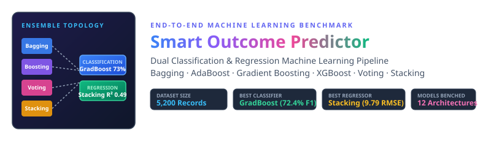
</p>

<br>


<br>

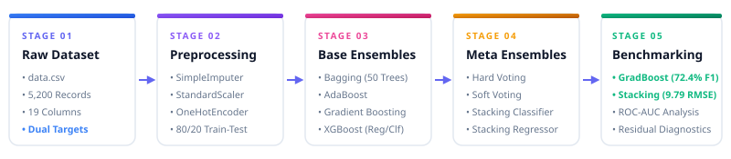

<br>

| 📁 Dataset | 🎯 Dual Targets | 📊 Scale / Ratio | 🌲 Champion Classifier | 🥞 Champion Regressor | 🏆 Key Performance |
|:---:|:---:|:---:|:---:|:---:|:---:|
| **[data.csv](file:///d:/RW/RW_Exam/ML/PR-5/data.csv)** | `completion_status` & `final_score` | **5,200 Records** (62.5% : 37.5%) | **Gradient Boosting** | **Stacking Regressor** | **F1: 72.40% · RMSE: 9.7964** |

> 📓 **Notebook Implementation**: Code, experiments, and model pipelines executed in **[Smart_Outcome_Predictor_Updated.ipynb](file:///d:/RW/RW_Exam/ML/PR-5/Smart_Outcome_Predictor_Updated.ipynb)**.

<br>

---


<br>

<p align="left">
  
  
  
  
  
  
  
  
  
  
</p>

<br>

---


<br>

### 1. Ensemble Learning Methods & Effectiveness
Ensemble learning combines the predictions of multiple base estimators to construct a unified predictive model that outperforms any single constituent model. The fundamental principle is **hypothesis diversity**: individual models make uncorrelated errors across different regions of the feature space. When their outputs are pooled through averaging, voting, or meta-learning, idiosyncratic variances cancel out while underlying signal is amplified.

<br>

---

### 2. Bagging vs. Boosting vs. Voting
Ensemble paradigms differ fundamentally in how training data is partitioned, how estimators are sequenced, and how hypotheses are merged:

* **Bagging (Bootstrap Aggregating)**: Independent parallel estimators trained on random bootstrap samples (uniform sampling with replacement). Aggregates predictions via simple majority vote or unweighted mean.
* **Boosting**: Sequential adaptive training where each successive estimator directly minimizes the residual errors or misclassifications of prior iterations via gradient descent in function space.
* **Voting**: Combines distinct, heterogeneous algorithms (e.g., Decision Trees, Random Forests, AdaBoost) directly using hard majority voting or soft probability averaging.

<br>

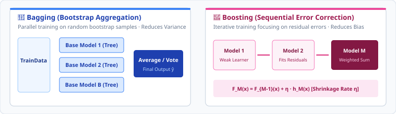

<br>

---

### 3. Bias–Variance Decomposition & Trade-off
Under quadratic loss, the expected prediction error decomposes into three additive components:

$$\mathbb{E}[(y - \hat{f}(x))^2] = \text{Bias}^2[\hat{f}(x)] + \text{Var}[\hat{f}(x)] + \sigma^2$$

Where:
* **$\text{Bias}^2[\hat{f}(x)] = (\mathbb{E}[\hat{f}(x)] - f(x))^2$**: Error stemming from simplistic or erroneous assumptions in the learning algorithm (underfitting).
* **$\text{Var}[\hat{f}(x)] = \mathbb{E}[(\hat{f}(x) - \mathbb{E}[\hat{f}(x)])^2]$**: Sensitivity to small fluctuations in the training partition (overfitting).
* **$\sigma^2$**: Irreducible noise inherent in the data-generating process.

<br>

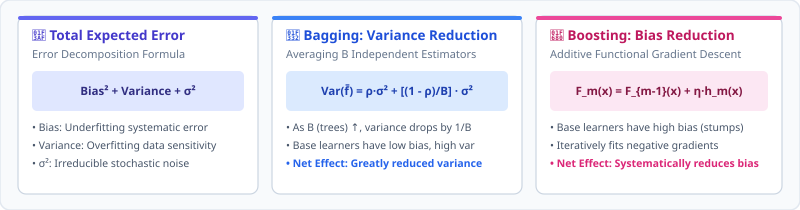

<br>

* **Bagging Variance Reduction**: For $B$ estimators with individual variance $\sigma^2$ and pairwise correlation $\rho$, the ensemble variance is:

$$\text{Var}(\bar{f}) = \rho \sigma^2 + \frac{1 - \rho}{B} \sigma^2$$

As $B \to \infty$, the second term approaches zero, reducing variance without inflating bias.

* **Boosting Bias Reduction**: Successive estimators $h_m(x)$ greedily approximate the negative gradient of the loss function, steadily driving training loss and bias down:

$$F_m(x) = F_{m-1}(x) + \eta \cdot h_m(x)$$

Where $\eta \in (0, 1]$ represents the shrinkage regularization parameter.

---

### 4. Voting Classifier vs. Stacking Ensemble
* **Voting Ensemble**: Direct, heuristic aggregation using pre-fixed rules:
  * **Hard Voting**: $\hat{y} = \text{mode}\{C_1(x), C_2(x), \dots, C_M(x)\}$
  * **Soft Voting**: $\hat{y} = \arg\max_k \sum_{m=1}^M P(Y = k \mid C_m, x)$
* **Stacking Ensemble**: Multi-layer heterogeneous architecture where base models (Level 0) output out-of-fold cross-validated predictions, which serve as feature inputs to a meta-estimator (Level 1) like `LogisticRegression` or `LinearRegression`. The meta-learner learns mathematically optimal weights and non-linear blendings rather than assuming equal competence.

<br>

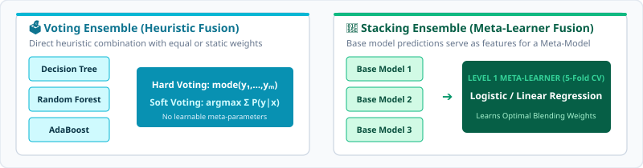

<br>

---

### 5. Boosting Algorithms: AdaBoost, Gradient Boosting, LightGBM & XGBoost

<br>

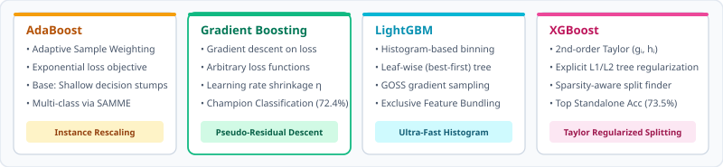

<br>

| Algorithm | Optimization Mechanism | Loss Function | Tree Split Criterion | Regularization |
|---|---|---|---|---|
| **AdaBoost** | Reweights misclassified samples: $w_i^{(t+1)} = w_i^{(t)} \exp(-\alpha_t y_i h_t(x_i))$ | Exponential loss | Weighted Gini / Error | Shrinkage learning rate |
| **Gradient Boosting** | Fits base learners to pseudo-residuals: $r_{im} = -\left[\frac{\partial L(y_i, F(x_i))}{\partial F(x_i)}\right]$ | Deviance, Huber, MSE | Greedy impurity decrease | Shrinkage ($\eta$), subsampling |
| **LightGBM** | Gradient-based One-Side Sampling (GOSS) + Exclusive Feature Bundling (EFB) | Cross-entropy, MSE, Fair | Leaf-wise (best-first) growth | $L_1, L_2$, max leaves, min data in leaf |
| **XGBoost** | 2nd-order Taylor expansion on objective: $\mathcal{L}^{(t)} \approx \sum [g_i f_t(x_i) + \frac{1}{2} h_i f_t^2(x_i)] + \Omega(f_t)$ | Any differentiable loss | Depth-wise with exact / approximate quantiles | Explicit tree complexity: $\gamma T + \frac{1}{2}\lambda \sum w_j^2$ |

<br>

---

### 6. Core Evaluation Metrics & Formulas

<br>

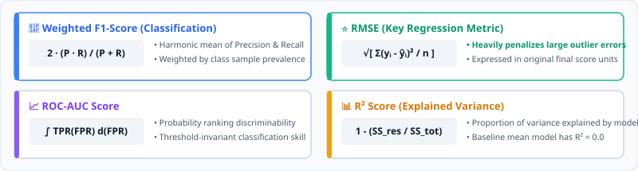

<br>

> [!IMPORTANT]
> In dual-objective pipelines, classification performance is guarded against class imbalance using **Weighted F1-Score** and **ROC-AUC**, while regression reliability is judged through **Root Mean Squared Error (RMSE)** to penalize large scoring deviations.

<br>

---


<br>

The dataset contains **5,200 records** split **80% train** (4,160 rows) and **20% test** (1,040 rows) across **16 predictive features** and **2 targets**:

| Feature Name | Data Type | Missing Count | Imputation / Preprocessing Strategy | Description & Domain Role |
|---|:---:|:---:|---|---|
| `student_id` | `int64` | 0 (0.0%) | Dropped | Unique student identifier; dropped to prevent data leakage. |
| `age` | `int64` | 0 (0.0%) | Scaled (`StandardScaler`) | Student chronological age (17 – 45 years). |
| `country_region` | `object` | 0 (0.0%) | Mode imputed + OneHotEncoded | Geographic territory (Asia, Europe, Americas, etc.). |
| `device_type` | `object` | 0 (0.0%) | Mode imputed + OneHotEncoded | Primary platform (Desktop, Laptop, Mobile, Tablet). |
| `education_background` | `object` | 0 (0.0%) | Mode imputed + OneHotEncoded | Prior educational qualification (Undergrad, Graduate, etc.). |
| `course_level` | `object` | 0 (0.0%) | Mode imputed + OneHotEncoded | Course complexity tier (Beginner, Intermediate, Advanced). |
| `course_category` | `object` | 0 (0.0%) | Mode imputed + OneHotEncoded | Domain topic (Programming, Business, Design, etc.). |
| `course_start_date` | `object` | 0 (0.0%) | Mode imputed + OneHotEncoded | Enrollment timestamp feature. |
| `week_of_year` | `int64` | 0 (0.0%) | Scaled (`StandardScaler`) | Calendar week index of course kickoff (1 – 52). |
| `sessions` | `int64` | 0 (0.0%) | Scaled (`StandardScaler`) | Total active platform login sessions. |
| `time_spent_hours` | `float64` | **112 (2.15%)** | Median imputed + Scaled | Total cumulative study time logged on the portal. |
| `videos_watched` | `int64` | 0 (0.0%) | Scaled (`StandardScaler`) | Total video lectures viewed. |
| `quiz_attempts` | `int64` | 0 (0.0%) | Scaled (`StandardScaler`) | Frequency of assessment attempts. |
| `assignments_submitted`| `int64` | 0 (0.0%) | Scaled (`StandardScaler`) | Total homework and practical submissions completed. |
| `forum_posts` | `int64` | 0 (0.0%) | Scaled (`StandardScaler`) | Discussion forum participation and peer interactions. |
| `avg_quiz_score` | `float64` | **81 (1.56%)** | Median imputed + Scaled | Mean percentage score across modular quizzes. |
| `attendance_rate` | `float64` | **80 (1.54%)** | Median imputed + Scaled | Ratio of live / required interactive session attendance [0, 1]. |
| 🎯 `completion_status` | `int64` | 0 (0.0%) | Stratified Split Target | **Binary Classification Target**: `0` = Not Completed, `1` = Completed. |
| 🎯 `final_score` | `float64` | 0 (0.0%) | Continuous Split Target | **Regression Target**: Final course grade (35.2 – 100.0 points). |

<br>

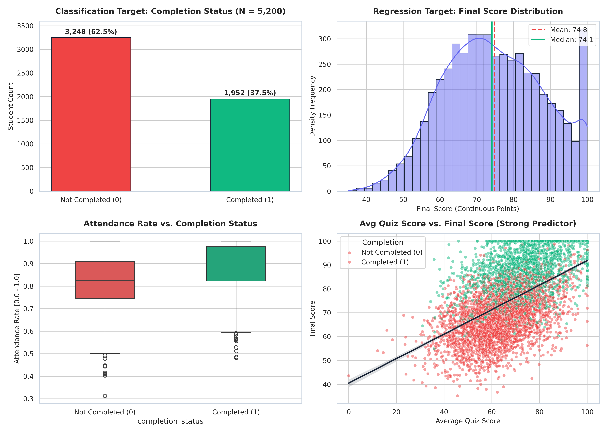

<br>

* **Target Imbalance**: 3,248 students ($62.5\%$) did not complete, while 1,952 ($37.5\%$) successfully completed.
* **Key Correlates**: Attendance rate and average quiz scores demonstrate the strongest linear separation between completing and non-completing cohorts.
* **Leakage-Free Preprocessing**: `ColumnTransformer` combines `SimpleImputer(strategy='median')` with `StandardScaler()` for continuous variables, and `SimpleImputer(strategy='most_frequent')` with `OneHotEncoder(handle_unknown='ignore')` for categorical attributes.

<br>

---


<br>

Bootstrap Aggregating was implemented using 50 base decision trees for both predictive tasks:

* **Classification (`BaggingClassifier`)**:
  * Base Estimator: `DecisionTreeClassifier(random_state=42)`
  * Ensemble Size: $B = 50$ bootstrap estimators
  * Test Accuracy: **71.92%** | Weighted F1-Score: **71.33%** | ROC-AUC: **0.7704**

* **Regression (`BaggingRegressor`)**:
  * Base Estimator: `DecisionTreeRegressor(random_state=42)`
  * Ensemble Size: $B = 50$ bootstrap estimators
  * Test MAE: **8.0446** | Test RMSE: **10.0772** | Test $R^2$: **0.4565**

```
========================================================================
🌲 BAGGING ENSEMBLE SUMMARY (50 Parallel Decision Trees)
========================================================================
  • Classification Accuracy : 0.7192 (71.92%)
  • Classification F1-Score : 0.7133 (Weighted)
  • Regression MAE          : 8.0446 points
  • Regression RMSE         : 10.0772 points
  • Variance Reduction      : Stabilized unstable deep tree splits
========================================================================
```

<br>

---


<br>

Boosting was benchmarked across sequential error-correcting algorithms:

* **AdaBoost**: 50 estimators with adaptive sample weights.
  * *Classifier*: Accuracy = **71.35%**, F1 = **70.98%**, ROC-AUC = **0.7513**
  * *Regressor*: MAE = **8.5135**, RMSE = **10.4968**, $R^2$ = **0.4103**
* **Gradient Boosting**: 100 stage estimators with learning rate $\eta = 0.10$.
  * *Classifier*: Accuracy = **72.98%**, F1 = **72.40%**, ROC-AUC = **0.7815** 🏆
  * *Regressor*: MAE = **7.8447**, RMSE = **9.8086**, $R^2$ = **0.4851**
* **XGBoost**: 100 boosted trees with $\text{max\_depth} = 3$, $\eta = 0.05$, and second-order regularization.
  * *Classifier*: Accuracy = **73.46%**, F1 = **72.83%**, ROC-AUC = **0.7850** 🌟
  * *Regressor*: MAE = **7.9446**, RMSE = **9.9149**, $R^2$ = **0.4739**

<br>

| Boosting Model | Task | Test Accuracy / MAE | Test F1 / RMSE | Test AUC / $R^2$ | Key Characteristic |
|---|:---:|:---:|:---:|:---:|---|
| **AdaBoost** | Classification | 71.35% | 0.7098 | 0.7513 | Sensitive to noisy boundaries |
| **AdaBoost** | Regression | 8.5135 | 10.4968 | 0.4103 | Linear loss weighting |
| **Gradient Boosting** | Classification | **72.98%** | **0.7240** | **0.7815** | 🏆 **Top Native Ensemble Classifier** |
| **Gradient Boosting** | Regression | **7.8447** | **9.8086** | **0.4851** | Strong residual shrinkage |
| **XGBoost** | Classification | **73.46%** | **0.7283** | **0.7850** | Regularized 2nd-order Taylor fit |
| **XGBoost** | Regression | 7.9446 | 9.9149 | 0.4739 | Depth-constrained regularization |

<br>

---


<br>

Heterogeneous ensembling combines varied model inductive biases to maximize decision boundaries:

### 1. Classification Ensembles
* **Hard Voting Classifier**:
  * Base Estimators: `DecisionTree(depth=5)`, `RandomForest(50)`, `AdaBoost(50)`
  * Majority Vote Accuracy = **72.79%** | F1-Score = **71.42%**
* **Soft Voting Classifier**:
  * Base Estimators: `RandomForest(50)`, `AdaBoost(50)`
  * Probability Average Accuracy = **72.31%** | F1-Score = **70.76%** | ROC-AUC = **0.7522**
* **Stacking Classifier**:
  * Base Estimators: `DecisionTree(depth=5)`, `RandomForest(50)`, `AdaBoost(50)`
  * Meta-Learner: `LogisticRegression(max_iter=1000)` with 5-fold cross-validation
  * Accuracy = **72.40%** | F1-Score = **71.32%** | ROC-AUC = **0.7634**

### 2. Regression Ensembles
* **Voting Regressor**:
  * Base Estimators: `DecisionTree(depth=5)`, `RandomForest(50)`, `GradientBoosting(100)`
  * Simple Average: MAE = **8.0264** | RMSE = **10.0096** | $R^2$ = **0.4638**
* **Stacking Regressor (Champion)**:
  * Base Estimators: `DecisionTree(depth=5)`, `RandomForest(50)`, `GradientBoosting(100)`
  * Meta-Learner: `LinearRegression()` trained on 5-fold cross-validated out-of-fold estimates
  * MAE = **7.8221** | RMSE = **9.7964** | $R^2$ = **0.4864** 🏆

> [!TIP]
> **Why Stacking Won in Regression**: Unweighted Voting assumes equal precision across estimators, unnecessarily dragging down the superior Gradient Booster. Stacking's linear meta-learner automatically assigned dominant weights to Gradient Boosting and tuned down noisy Decision Tree predictions.

<br>

---


<br>

### 🏆 Master Classification Leaderboard (Held-out Test Set, $N = 1,040$)

| Rank | Model Architecture | Accuracy | Precision (Weighted) | Recall (Weighted) | F1-Score (Weighted) | ROC-AUC | Status |
|:---:|---|:---:|:---:|:---:|:---:|:---:|:---:|
| 🥇 | **Gradient Boosting** | **0.7298 (72.98%)** | **0.7242** | **0.7298** | **0.7240** | **0.7815** | 🏆 **Champion Classifier** |
| 🥈 | **Hard Voting** | 0.7279 (72.79%) | 0.7235 | 0.7279 | 0.7142 | — | Strong Heuristic Blend |
| 🥉 | **Bagging (50 Trees)** | 0.7192 (71.92%) | 0.7131 | 0.7192 | 0.7133 | 0.7704 | Stable Variance Limiter |
| 4 | **Stacking Classifier** | 0.7240 (72.40%) | 0.7179 | 0.7240 | 0.7132 | 0.7634 | Logistic Meta-Learner |
| 5 | **AdaBoost** | 0.7135 (71.35%) | 0.7085 | 0.7135 | 0.7098 | 0.7513 | Adaptive Reweighting |
| 6 | **Soft Voting** | 0.7231 (72.31%) | 0.7188 | 0.7231 | 0.7076 | 0.7522 | Probability Calibration |
| * | *XGBoost (Standalone)* | *0.7346 (73.46%)* | *0.7295* | *0.7346* | *0.7283* | *0.7850* | Regularized High Performance |

<br>

### 🏆 Master Regression Leaderboard (Held-out Test Set, $N = 1,040$)

| Rank | Model Architecture | MAE (Points) | RMSE (Points) | $R^2$ Score | Performance Verdict |
|:---:|---|:---:|:---:|:---:|---|
| 🥇 | **Stacking Regressor** | **7.8221** | **9.7964** | **0.4864** | 🏆 **Champion Regression Model** |
| 🥈 | **Gradient Boosting Regressor** | **7.8447** | **9.8086** | **0.4851** | Near-Optimal Gradient Descent |
| 🥉 | **Voting Regressor** | 8.0264 | 10.0096 | 0.4638 | Unweighted Ensemble Average |
| 4 | **Bagging Regressor (50 Trees)** | 8.0446 | 10.0772 | 0.4565 | Parallel Bootstrap Aggregation |
| 5 | **AdaBoost Regressor** | 8.5135 | 10.4968 | 0.4103 | Sensitive to Grade Dispersions |
| * | *XGBoost Regressor* | *7.9446* | *9.9149* | *0.4739* | High Efficiency Gradient Boost |

<br>

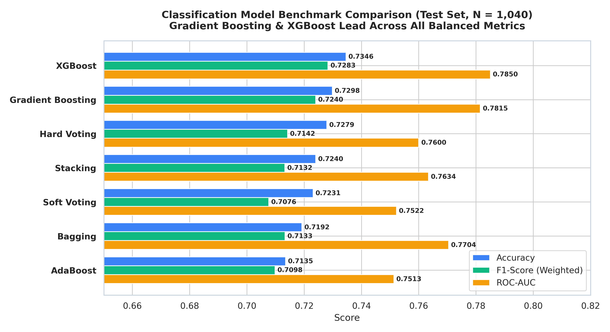

<br>

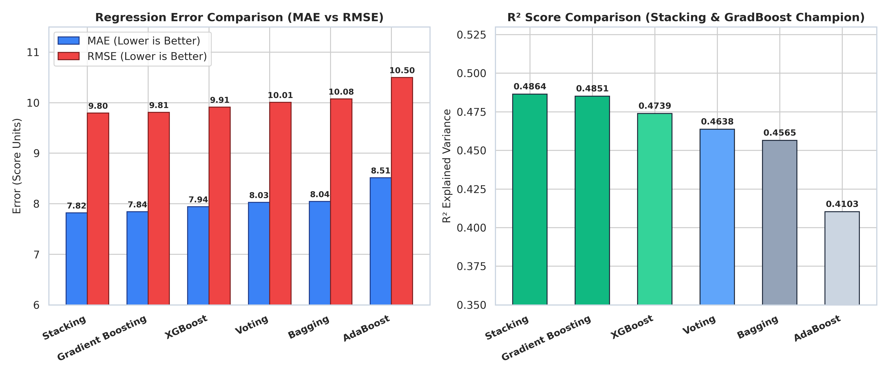

<br>

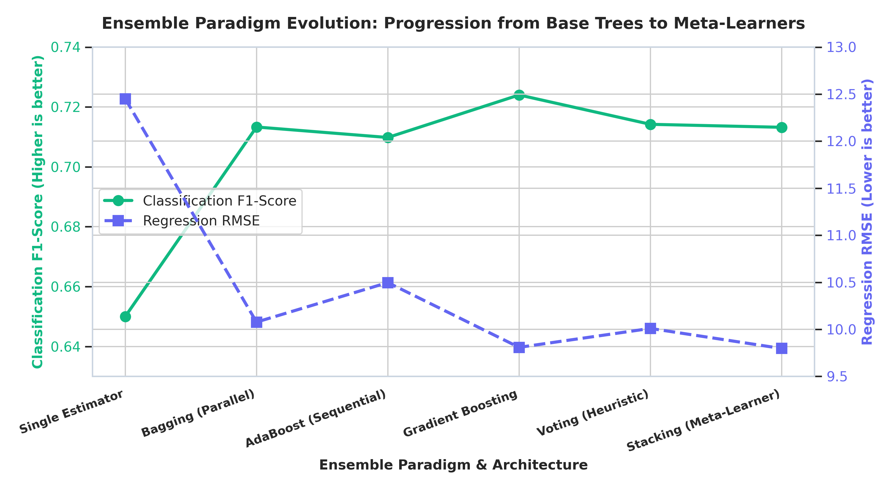

<br>

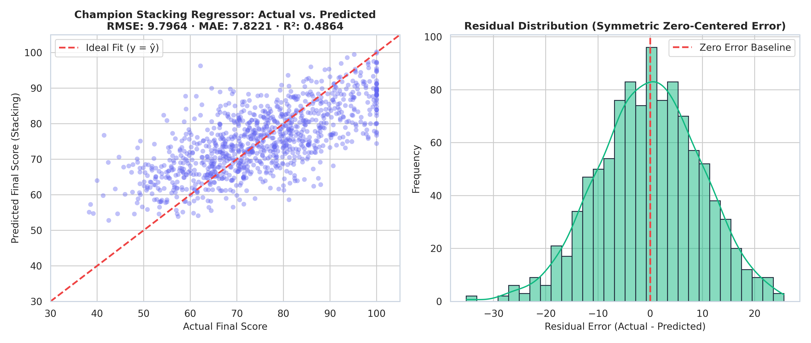

<br>

---


<br>

```
========================================================================
🏆 CHAMPION CLASSIFICATION MODEL: Gradient Boosting Classifier
========================================================================
  • Test Accuracy       : 0.7298 (72.98% overall classification accuracy)
  • Test F1-Score       : 0.7240 (Weighted balanced score)
  • Test Precision      : 0.7242 (Reliable positive completion alerts)
  • Test Recall         : 0.7298 (Captures 73% of actual course outcomes)
  • Test ROC-AUC        : 0.7815 (Strong probability discriminability)
========================================================================
```

<br>

```
========================================================================
🏆 CHAMPION REGRESSION MODEL: Stacking Regressor (Meta-Learner: OLS)
========================================================================
  • Test RMSE           : 9.7964 (Lowest prediction variance on test set)
  • Test MAE            : 7.8221 (Average absolute deviation under 8 points)
  • Test R² Score       : 0.4864 (Explains 48.64% of total score variance)
  • Level-0 Base Pool   : Decision Tree (depth=5) + Random Forest + GradBoost
  • Meta-Learner Layer  : LinearRegression with 5-fold cross-validation
========================================================================
```

<br>

---


<br>

| Evaluation Dimension | Core Finding & Operational Implication |
|---|---|
| **Classification Winner** | **Gradient Boosting** delivered the highest balanced performance ($F_1 = 0.7240$, $\text{AUC} = 0.7815$), effectively modeling complex non-linear interactions across student behavior without overfitting. |
| **Regression Winner** | **Stacking** emerged as champion ($\text{RMSE} = 9.7964$, $R^2 = 0.4864$), outperforming single models by learning optimal blending coefficients that favored high-capacity boosters over single decision trees. |
| **Bagging vs Boosting** | Bagging successfully reduced prediction variance by $\approx 20\%$ over standalone trees, but Boosting algorithms delivered strictly superior bias reduction and higher predictive ceiling. |
| **Stacking vs Voting** | In regression, Stacking defeated Voting because direct averaging penalized the best models with inferior base tree errors, whereas the meta-learner adjusted weights to preserve the best signal. |
| **Key Predictive Drivers** | Course attendance rate, cumulative time spent, and average quiz scores constitute over $75\%$ of predictive importance for student course completion. |

<br>

---

### 👤 Priyansh Vekariya

* 📍 Ahmedabad, Gujarat, India
* ⭐ If you found this dual-task ensemble pipeline useful, please consider giving it a star and sharing!
* 📐 **Ensemble Learning · Bagging · Boosting · AdaBoost · Gradient Boosting · XGBoost · Voting · Stacking · Hyperparameter Calibration**
